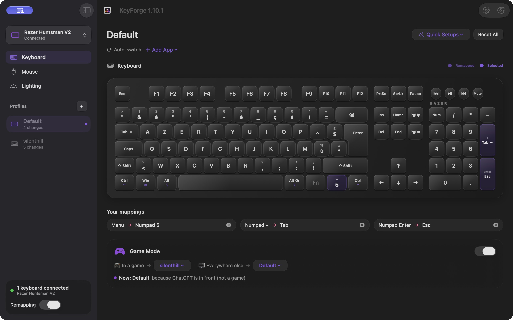
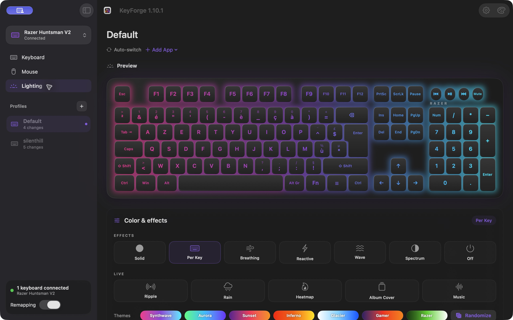
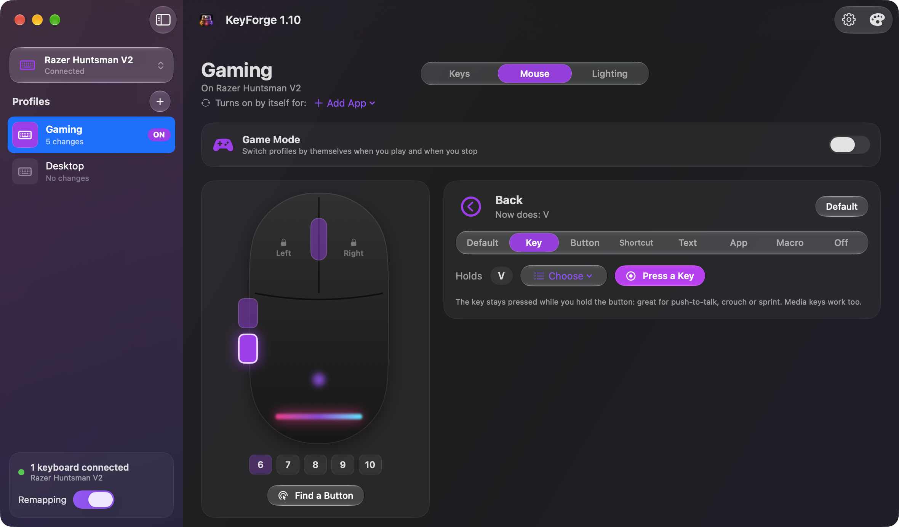
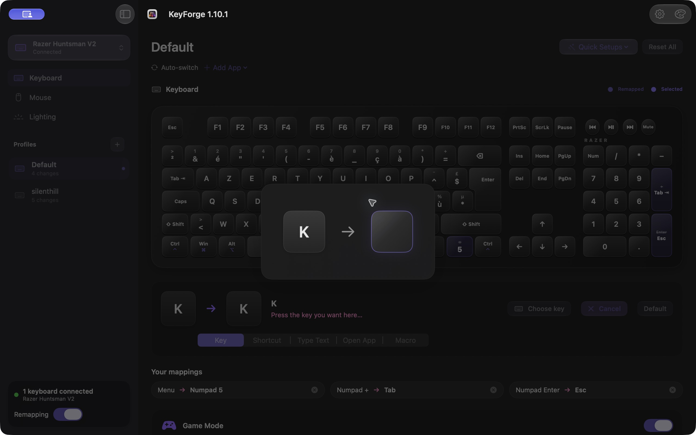

# KeyForge

HIIII, other keyboard remapper/ RGB modifier scked for me, so i made claude make myself this:
A macOS app to remap keys, run shortcuts and macros, and control the RGB lighting of a Razer Huntsman V2, without Razer Synapse. Key remapping works with any keyboard. i dont take any credit for the code.
I VIBECODED IT WIT CLAUDE ORIGINALLY FOR PERSONAL USE BUT IDK MAYBE SOMEONE NEED SOMETHING SIMILAR <3<3, sister app of [MP3 Tagger](https://github.com/silentrosehill/MP3Tagger).






## Appearance

A clean macOS workspace with native controls, a compact sidebar and neutral keycaps. Appearance supports System, Light and Dark modes, accent colors, and a persistent Glass opacity slider. Floating controls use native Liquid Glass on macOS 26 and later, with a frosted fallback on earlier supported versions. Reduce Transparency is respected, and opacity adjustments keep text fully readable.

## Features

**Keys**
- Your keyboard drawn on screen with your real layout's legends (AZERTY, QWERTZ, …); keys light up as you press them
- Click a key to edit it. Double-click a key, then press its replacement in the centered popup
- Media keys, volume, brightness, Mission Control, Launchpad, Spotlight, Fn, or disable a key
- Make a key send a shortcut, type text, open an app, or run a macro (shortcuts, text and pauses in a row)
- Quick setups: Mac modifiers, Caps Lock → Esc, media on F7–F12, disable the Win keys for gaming

**Mouse (any mouse)**
- Give the middle, back, forward and extra buttons a job: hold a key while the button is held (push-to-talk, crouch, media keys), act as another mouse button, send a shortcut, type text, open an app, run a macro, or do nothing
- "Find a Button" picks up extra side buttons; left and right click always stay as they are
- Mouse lighting for the Logitech G203 LIGHTSYNC (3 zones), Razer Viper Ultimate and Razer Mouse Dock: Sync with the keyboard, Solid, Per Zone, Breathing, Cycle, Wave, Off

**Any keyboard**
- Pick any connected keyboard; each one has its own profiles, all active at the same time, plus "All keyboards"
- Layouts: Full + media (Huntsman V2), Full, TKL, 60% and Mac, ISO or ANSI

**Profiles**
- As many profiles as you want; rename, duplicate, reorder
- Game Mode: pick a Game profile and a Desktop profile, and KeyForge switches by itself when any game comes to the front (Mac games, Steam games, Windows games in CrossOver/Wine) and back when you leave it
- Or switch for specific apps while they're in front
- ⌃⌥1 … ⌃⌥9 switch profiles; a popup in the top-left corner shows every switch, even over full-screen games
- Key changes, mouse buttons and lighting are all saved per profile

**Lighting (Razer Huntsman V2)**
- Solid, Breathing, Reactive, Wave, Spectrum, Off, with brightness
- Per Key: paint keys by clicking or dragging, Randomize, and premade themes (Synthwave, Aurora, Sunset, Inferno, Glacier, Gamer, Razer)
- Live effects: Ripple on key presses, Rain, a typing Heatmap, Album Cover (follows the song playing in MP3 Tagger) and Music (reacts to what your Mac plays)
- Pick a color from anywhere on screen, save your own colors, Caps Lock light
- Talks to the keyboard directly over USB (the same protocol as OpenRazer); no Synapse needed

**App**
- Native Liquid Glass controls, adjustable glass opacity, System/Light/Dark appearance, and accent colors that can follow your keyboard's RGB
- Lives in the menu bar, opens at login, re-applies everything when the keyboard is plugged back in

## Notes

- Key remapping uses macOS's own `hidutil`, so it needs no driver. If Razer's driver extensions (from Razer Synapse) are still active, macOS ignores remapping on the Razer keyboard: turn them off in System Settings → General → Login Items & Extensions → Driver Extensions.
- Shortcuts, macros, mouse buttons, Ripple and Heatmap need Accessibility (System Settings → Privacy & Security → Accessibility). They work on every keyboard, since macOS doesn't say which keyboard a key press came from.
- Music asks for permission to record system audio; nothing is recorded or saved.
- Keyboard lighting is only tested on the Huntsman V2 (USB 1532:026C); the LED map comes from OpenRGB. Mouse lighting uses OpenRGB's G203 LIGHTSYNC and Razer protocols; the Razer mice aren't tested yet.

## Build

Needs macOS 15 or later and the Xcode Command Line Tools.

```bash
git clone https://github.com/silentrosehill/KeyForge.git
cd KeyForge
./build.sh
open KeyForge.app
```

The app is signed ad hoc and not notarized, so macOS may ask you to allow it in System Settings → Privacy & Security the first time.
